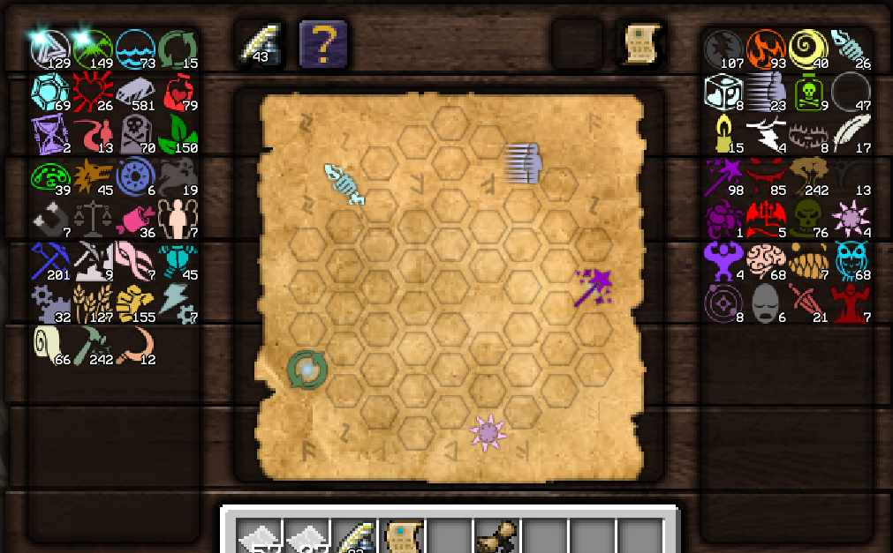
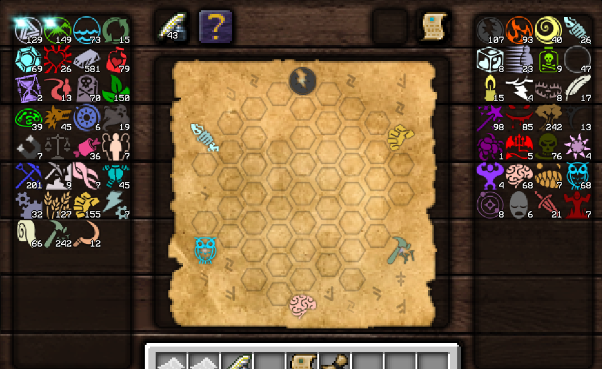

currently i have two research:  and 
neither of which should be hard to solve, however the mod fails at both, even with an increased time to solve (15s)
Investigate why that might be the case.

## Investigation

The resource-aware solver was using uniform-cost Dijkstra expansion. On a large open note, every reachable cell, aspect choice, and distinct remaining-resource ledger was queued at the same placement depth before the search made meaningful progress toward the next root. The screenshots both have five widely separated roots and many vacant cells, which triggers that state explosion; raising the timeout only allows more unrelated states to be enumerated.

The solver now uses resource-aware weighted A* ordering. It precomputes the minimum number of vacant cells from every board position to the current target and weights that estimate to prioritize useful states. Exact player/bonus/crafted ledgers remain part of state identity, so this does not restore the old unsafe resource pruning. Ledger fingerprints also reuse the solve's sorted aspect list instead of sorting all registered aspects for every visited state.

Verification performed:

- Isolated Java 8-targeted compilation of the changed solver/API/diagnostic sources passed.
- All ten deterministic diagnostics passed, including the abundance-biased bridge choice.
- The added regression is a 61-cell open board with five separated roots and completes within a 2,000 ms solver budget.
- An isolated `check assemble` reobfuscated build passed. No new distributable was retained because this working version is still collecting additions; the earlier algorithm-only test JAR was removed after it became stale.

Remaining verification: retry both pictured notes in game and confirm the produced plan is accepted by the server. Screenshots alone do not expose the serialized root coordinates/aspect identities needed to reproduce those exact notes offline.

## Follow-up instrumentation and search policy

Release status: packaged for 1.3.1-beta.1; see ../docs/RELEASE_NOTES.md. The working-version description below records the earlier development stage.

This remains an open working version while additional requests are collected. Solver calculations now write detailed traces to `.minecraft/logs/thaumcraftresearchsolver/`; attach the newest trace after reproducing a slow or failed note. The search policy is now weighted, first-complete A* rather than global-best A*: it favors reaching roots, uses high-stock aspects as the local tie-breaker, returns immediately on a complete plan, and only changes root order when an earlier order fails. The trace also ranks abundant directly related pairs so repeated bridges such as Ordo/Instrumentum are visible when available.
